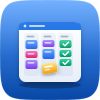
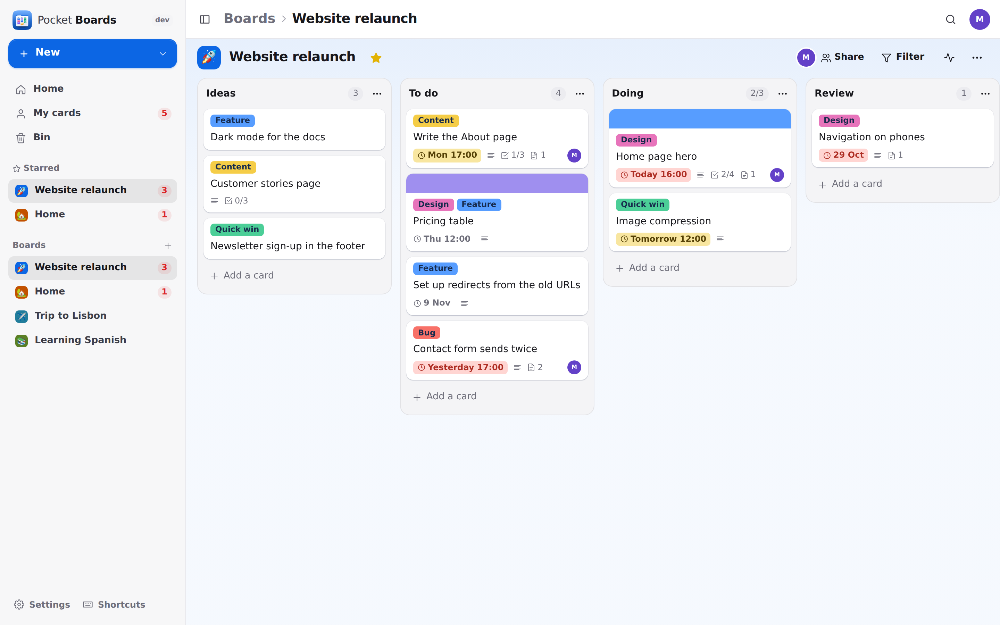
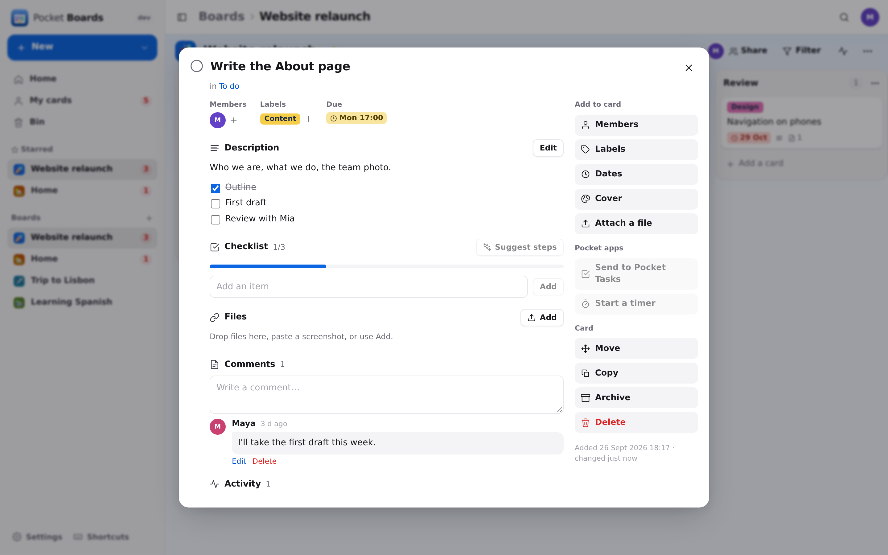
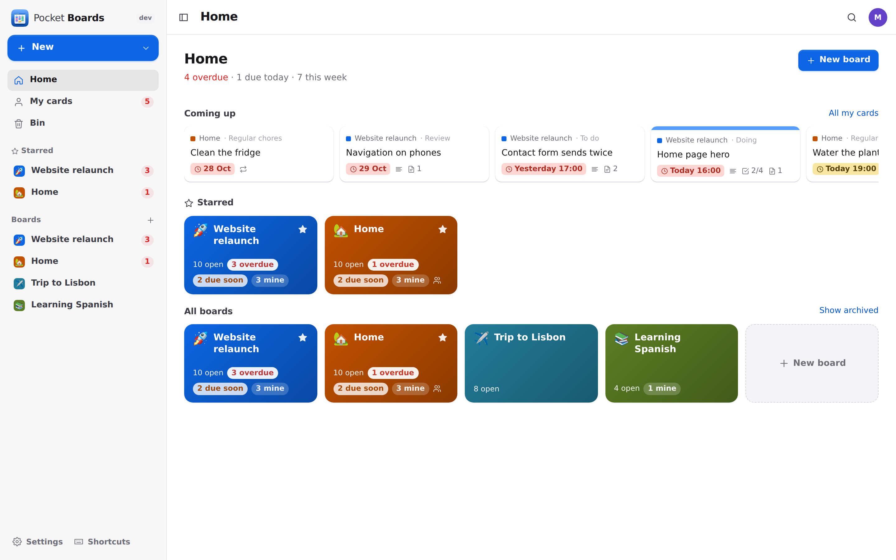
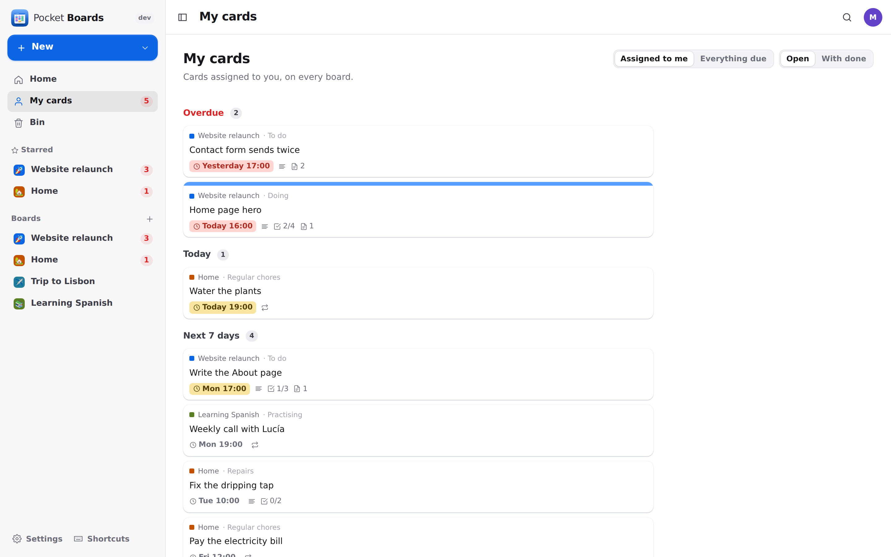
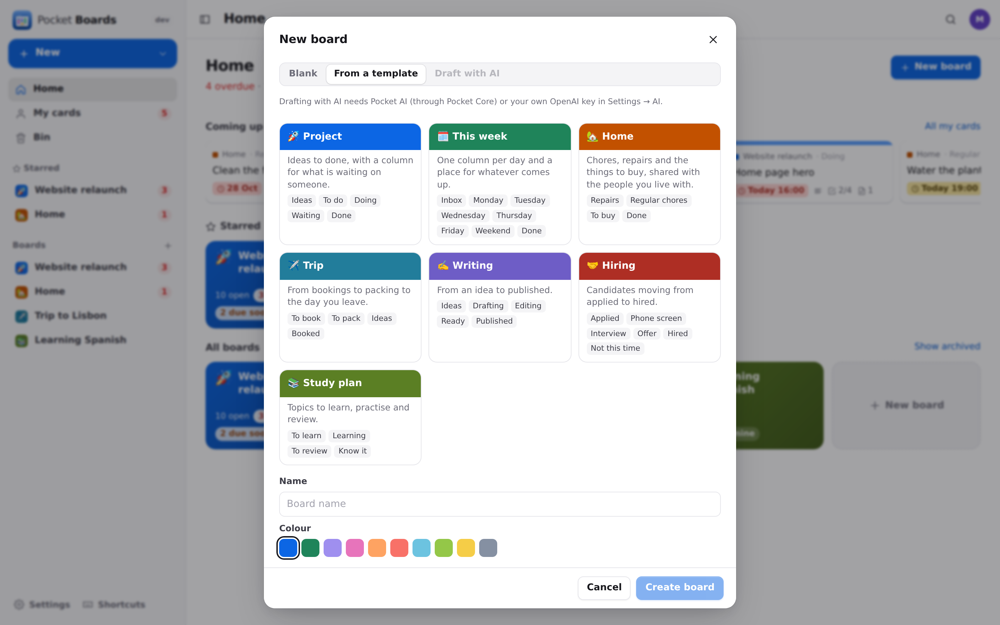
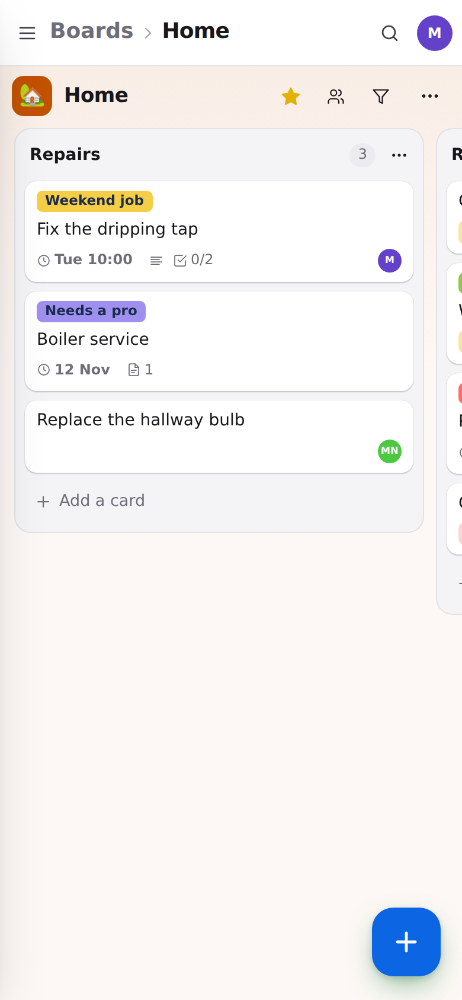
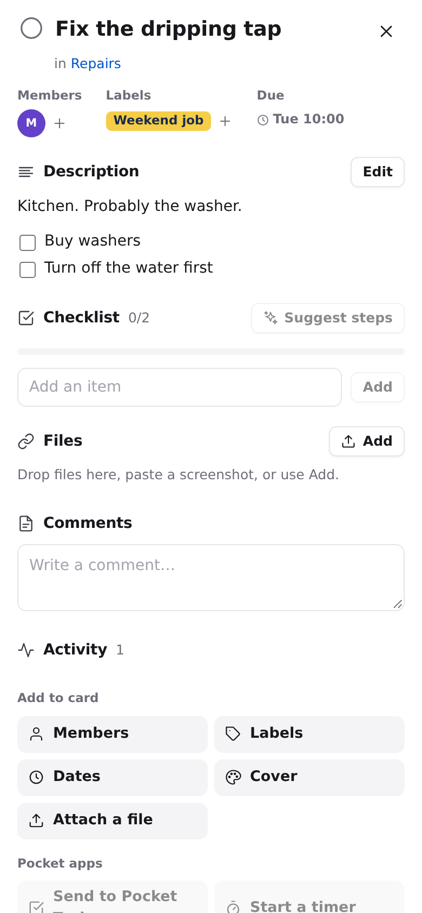

<p align="center"></p>
<h1 align="center">Pocket Boards</h1>
<p align="center">Boards, lists and cards on your own server, like Trello or Nextcloud Deck. Cards have labels, due dates with reminders, checklists, comments and files. Repeating cards come back on their own, and a "done" list ticks cards off as you drag them in. Share a board with the people you live or work with and see changes as they happen. My cards gathers what's yours across every board. Deck apps work with it, your Deck and Trello boards import in a click, and cards go to Pocket Tasks or start your timer in Pocket Time.<br>One Go binary, one SQLite file, one volume. Part of the Pocket apps; works on its own too.</p>
<p align="center">
  <a href="https://github.com/abjelosevic88/pocket-homelab-boards/actions"></a>
  <a href="https://github.com/abjelosevic88/pocket-homelab-boards/pkgs/container/pocket-homelab-boards"></a>
  <a href="LICENSE"></a>
</p>

---

<p align="center"></p>

<table>
  <tr>
    <td width="50%"></td>
    <td width="50%"></td>
  </tr>
  <tr>
    <td align="center"><sub>A card: Markdown description with a checklist you tick in place, labels, dates, comments, files and its history.</sub></td>
    <td align="center"><sub>Home: your boards with what is overdue or due soon on each, and the next week at a glance.</sub></td>
  </tr>
  <tr>
    <td width="50%"></td>
    <td width="50%"></td>
  </tr>
  <tr>
    <td align="center"><sub>My cards: everything given to you on any board, grouped by overdue, today, this week and later.</sub></td>
    <td align="center"><sub>Start blank, from a template (project, week, home, trip…) or let AI draft the board for your goal.</sub></td>
  </tr>
</table>

<p align="center">
  &nbsp;&nbsp;
  
</p>

## What it does

- **Boards, lists, cards**: drag cards within and between lists (long-press on phones), reorder lists, move a card to another board. Each board has its own colour, emoji, labels and description. Archive what's finished and get it back any time. Deleted boards, lists and cards wait in the bin for 30 days.
- **Cards**: a Markdown description whose task lines (`- [ ]`) are the checklist, ticked right on the card with a progress bar. Cards also get labels, a start and due date, a cover colour, the people assigned, comments, files (pictures show inline) and the card's history.
- **Quick add**: type `Fix the tap #home @mia !sat !10:00` and the label, the person and the due date are filled in for you.
- **Done lists and limits**: mark a list as the done list and cards dragged into it are ticked off. Dragging them out reopens them. A list can have a limit on how many cards it holds (it turns amber when you go over).
- **Repeating cards**: daily, on weekdays, weekly, monthly or yearly. When you finish one, the next appears with its next due date and its checklist unticked.
- **Shared boards**: share with people on your box as an editor or a viewer (viewers can still comment). Changes show up live on everyone's screen, and admins see nobody else's boards.
- **My cards**: everything assigned to you across all boards, by overdue, today, this week, later and no date. Search covers every board, and ⌘K jumps anywhere.
- **Reminders**: a nudge before something is due (you choose how long before), a note when someone gives you a card or comments on yours, and an optional morning list of what's due today. These go out through Apprise, ntfy or a webhook.
- **Calendar feed**: your due cards as a private `.ics` address for any calendar app.
- **Templates and AI**: start from a project, week, home, trip, writing, hiring or study board. Or describe your goal and let AI draft the lists and first cards, and ask it for the steps of a card. AI runs through Pocket AI or your own OpenAI-compatible key.
- **Nextcloud Deck–compatible API**: Deck apps and scripts written for Deck work against Pocket Boards. Clients sign in with Nextcloud's login flow in the browser or with your email and an API token. See [docs/api.md](docs/api.md#nextcloud-deck-compatible-api).
- **Import**: your Nextcloud Deck boards (with comments and files) and Trello board exports (checklists, labels and comments included). Running an import again updates it and never makes duplicates. Export everything as JSON or CSV.
- **Everyone their own**: each person has their own boards, settings and connections. A board is only seen by the people it's shared with.

## Run it

```sh
docker run -d --name pocket-boards -p 8080:8080 -v ./data:/data \
  -e BASE_URL=https://boards.example.com -e SECURE_COOKIES=true \
  ghcr.io/abjelosevic88/pocket-homelab-boards:latest
```

Or run `docker compose up -d` with [docker-compose.yml](docker-compose.yml). Open it, create the first account and make your first board. All options are in [docs/configuration.md](docs/configuration.md), and the API is in [docs/api.md](docs/api.md).

## With Pocket Core

Set `CORE_URL` and `CORE_REGISTRATION_KEY` and Boards joins the box. People sign in with Pocket Core, and app links connect each person's boards to their own Pocket apps with nothing to paste:
- **Pocket Tasks**: send a card to your task list, with its due date and a link back (`tasks:write`).
- **Pocket Time**: start your timer on a card. The time lands back on the card through the worklog contract (`time:write`, offers `worklog:read|write`).
- **Pocket AI**: board drafts and checklist steps.
- **Nextcloud**: your Nextcloud account from Core for the Deck import.

Other Pocket apps can read your boards (`boards:read`, for Pocket Day's journal or a calendar overlay) or add and move cards (`boards:write`).

Events go on the bus: `boards.card_created`, `boards.card_moved`, `boards.card_done`, `boards.card_due`, `boards.card_assigned` and `boards.comment_added`.

Without Core, every connection can be made directly with a URL and a token. The Core-only choices stay visible, greyed out.

## Develop

```sh
make dev     # API on :8080 with demo data + Vite on :5173
make test    # go vet, go test, tsc
make         # web + binary
```

MIT licensed.
